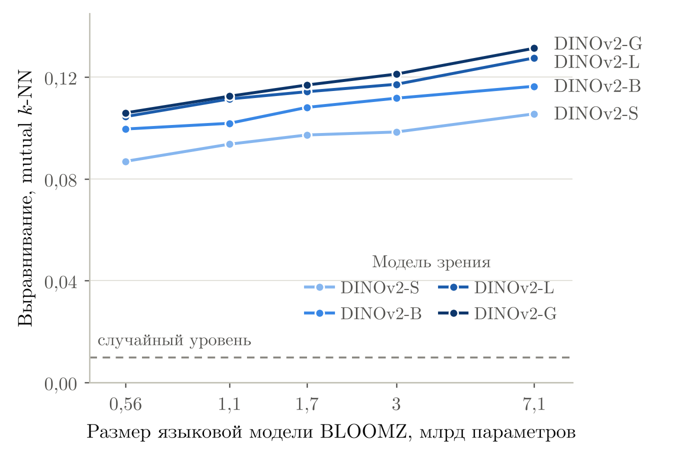

# Сходимость представлений нейросетей на примере рекомендательных систем

Код, тексты и результаты ВКР «Сходимость представлений нейросетей разных архитектур,
модальностей и задач на примере рекомендательных систем»
(В. А. Талменев, Центральный университет, научный трек).

Гипотеза платоновского представления (Huh et al., 2024) утверждает, что с ростом масштаба
модели разных архитектур и модальностей приходят к похожим представлениям. В работе она
проверяется на рекомендательных моделях, которые учатся по истории взаимодействий
пользователей с товарами. Первый этап — воспроизведение исходного эксперимента на парах
«изображение — подпись» — выполнен; следующий — модели на MovieLens-1M.

## Статья и слайды

- [Статья](tex/article.pdf): введение, обзор литературы, постановка задачи, воспроизведение
  базового эксперимента и план дальнейшей работы.
- [Слайды](tex/slides.pdf) к докладу.
- Исходники: [`tex/article.tex`](tex/article.tex), [`tex/slides.tex`](tex/slides.tex),
  список литературы [`tex/refs.bib`](tex/refs.bib).

## Результаты

Mutual k-NN (k = 10) между языковыми моделями BLOOMZ и моделями зрения DINOv2
на 1024 парах WIT, лучшая пара слоёв:

| Языковая модель | DINOv2-S | DINOv2-B | DINOv2-L | DINOv2-G |
|-----------------|---------:|---------:|---------:|---------:|
| BLOOMZ-560m     |    0,087 |    0,100 |    0,104 |    0,106 |
| BLOOMZ-1b1      |    0,094 |    0,102 |    0,111 |    0,113 |
| BLOOMZ-1b7      |    0,097 |    0,108 |    0,114 |    0,117 |
| BLOOMZ-3b       |    0,098 |    0,112 |    0,117 |    0,121 |
| BLOOMZ-7b1      |    0,106 |    0,116 |    0,128 |    0,131 |

Случайный уровень k/(n − 1) ≈ 0,0098, на перемешанных парах получено 0,009–0,011.
Выравнивание растёт с размером обеих моделей во всех парах; для сравнения,
у Koepke et al. (2026) для OpenLLaMA-3B и DINOv2-B — 0,135.



## Структура проекта

```
rep-convergence-recsys/
├── src/repconv/
│   ├── metrics.py        mutual k-NN, подготовка признаков, контроль на перемешанных парах
│   ├── features.py       признаки языковых моделей и моделей зрения по слоям, bits-per-byte
│   ├── data.py           загрузка WIT-1024
│   ├── plotting.py       график выравнивания в стиле статьи или слайдов
│   └── utils.py          очистка памяти GPU и кэша весов
├── scripts/
│   ├── run_wit1024.py    эксперимент целиком: признаки, выравнивание, таблица, график
│   └── make_figures.py   рисунки для tex/ по готовой таблице
├── notebooks/
│   └── wit1024_kaggle.ipynb
├── results/wit1024/      результаты запуска на Kaggle (2 × NVIDIA T4)
│   ├── alignment.csv     все пары моделей: выравнивание, контроль, лучшие слои, bpb
│   ├── sanity_check.csv  мера на синтетических данных с известным ответом
│   ├── summary.json
│   └── figures/
├── tests/
└── tex/                  статья и слайды (LaTeX), refs.bib, рисунки
```

## Установка

Python 3.10+:

```bash
git clone https://github.com/velton00/rep-convergence-recsys.git
cd rep-convergence-recsys
pip install -e ".[dev]"
```

## Запуск эксперимента

```bash
python scripts/run_wit1024.py --out results/wit1024
```

Нужны две GPU по 16 ГБ или одна на 24 ГБ (BLOOMZ-7b1 в fp16 занимает около 14 ГБ) и около 16 ГБ
свободного диска: веса каждой модели удаляются после использования, флаг `--keep-weights`
это отключает. Признаки сохраняются в `results/wit1024/features`, поэтому прерванный запуск
продолжается с той модели, на которой остановился. Набор моделей задаётся флагами `--llm`
и `--lvm`, например:

```bash
python scripts/run_wit1024.py --out results/test \
    --llm bigscience/bloomz-560m --lvm vit_small_patch14_dinov2.lvd142m
```

### На Kaggle

1. File → Import Notebook → `notebooks/wit1024_kaggle.ipynb`.
2. Settings → Accelerator → GPU T4 x2, Settings → Internet → On.
3. Save Version → Save & Run All. Ноутбук клонирует этот репозиторий; если вместо этого
   добавить архив проекта через Add Input → Upload, он возьмёт код из `/kaggle/input`.
   Через час в Output появится `wit1024_results.zip`.

## Рисунки, статья и слайды

```bash
python scripts/make_figures.py results/wit1024/alignment.csv tex/figures
cd tex
latexmk -pdf article.tex
latexmk -pdf slides.tex
```

Без latexmk: pdfLaTeX → BibTeX → pdfLaTeX → pdfLaTeX. Для Overleaf достаточно загрузить
папку `tex/`.

## Тесты

```bash
pytest
ruff check .
```

Тесты не требуют GPU и сети. Мера сверяется с полным перебором и со случаями, где ответ
известен заранее; на синтетических данных она даёт те же значения, что и код авторов
в запуске на Kaggle. Извлечение признаков проверяется на маленьких случайных моделях,
в том числе на то, что дополнение коротких подписей не меняет их представления.

## Литература

Нумерация совпадает со списком литературы в статье.

1. Huh M., Cheung B., Wang T., Isola P. [Position: The Platonic Representation Hypothesis](https://arxiv.org/abs/2405.07987) // ICML, 2024.
2. Maniparambil M. et al. [Do Vision and Language Encoders Represent the World Similarly?](https://arxiv.org/abs/2401.05224) // CVPR, 2024.
3. Sharma P. et al. [A Vision Check-up for Language Models](https://arxiv.org/abs/2401.01862) // CVPR, 2024.
4. Zhai J. et al. [Actions Speak Louder than Words: Trillion-Parameter Sequential Transducers for Generative Recommendations](https://arxiv.org/abs/2402.17152) // ICML, 2024.
5. Kang W.-C., McAuley J. [Self-Attentive Sequential Recommendation](https://arxiv.org/abs/1808.09781) // ICDM, 2018.
6. Sun F. et al. [BERT4Rec: Sequential Recommendation with Bidirectional Encoder Representations from Transformer](https://arxiv.org/abs/1904.06690) // CIKM, 2019.
7. Lenc K., Vedaldi A. [Understanding Image Representations by Measuring Their Equivariance and Equivalence](https://arxiv.org/abs/1411.5908) // CVPR, 2015.
8. Bansal Y., Nakkiran P., Barak B. [Revisiting Model Stitching to Compare Neural Representations](https://arxiv.org/abs/2106.07682) // NeurIPS, 2021.
9. Moschella L. et al. [Relative Representations Enable Zero-Shot Latent Space Communication](https://arxiv.org/abs/2209.15430) // ICLR, 2023.
10. Dravid A., Gandelsman Y., Efros A. A., Shocher A. [Rosetta Neurons: Mining the Common Units in a Model Zoo](https://arxiv.org/abs/2306.09346) // ICCV, 2023.
11. Merullo J., Castricato L., Eickhoff C., Pavlick E. [Linearly Mapping from Image to Text Space](https://arxiv.org/abs/2209.15162) // ICLR, 2023.
12. Jha R., Zhang C., Shmatikov V., Morris J. X. [Harnessing the Universal Geometry of Embeddings](https://arxiv.org/abs/2505.12540) // arXiv, 2025.
13. Balestriero R., LeCun Y. [Proving and Improving the Platonic Representation Hypothesis with JEPAs](https://arxiv.org/abs/2610.39302) // arXiv, 2026.
14. Hou Y. et al. [Towards Universal Sequence Representation Learning for Recommender Systems](https://arxiv.org/abs/2206.05941) // KDD, 2022.
15. Li J. et al. [Text Is All You Need: Learning Language Representations for Sequential Recommendation](https://arxiv.org/abs/2305.13731) // KDD, 2023.
16. Yuan Z. et al. [Where to Go Next for Recommender Systems? ID- vs. Modality-based Recommender Models Revisited](https://arxiv.org/abs/2303.13835) // SIGIR, 2023.
17. Sheng L. et al. [Language Representations Can be What Recommenders Need: Findings and Potentials](https://arxiv.org/abs/2407.05441) // ICLR, 2025.
18. Koepke A. S., Zverev D., Ginosar S., Efros A. A. [Back into Plato's Cave: Examining Cross-modal Representational Convergence at Scale](https://arxiv.org/abs/2604.18572) // arXiv, 2026.
19. Gröger F., Wen S., Brbić M. [Revisiting the Platonic Representation Hypothesis: An Aristotelian View](https://arxiv.org/abs/2602.14486) // arXiv, 2026.
20. Davari M. et al. [Reliability of CKA as a Similarity Measure in Deep Learning](https://arxiv.org/abs/2210.16156) // ICLR, 2023.
21. Collins L. et al. [Exploiting ID-Text Complementarity via Ensembling for Sequential Recommendation](https://arxiv.org/abs/2512.17820) // arXiv, 2025.
22. Iana A., Glavaš G., Paulheim H. [Peeling Back the Layers: An In-Depth Evaluation of Encoder Architectures in Neural News Recommenders](https://arxiv.org/abs/2410.01470) // INRA, 2024.
23. Lin C. et al. [Dreaming User Multimodal Representation Guided by The Platonic Representation Hypothesis for Micro-Video Recommendation](https://arxiv.org/abs/2410.03538) // arXiv, 2024.
24. Barkan O., Koenigstein N. [Item2Vec: Neural Item Embedding for Collaborative Filtering](https://arxiv.org/abs/1603.04259) // MLSP, 2016.
25. Kornblith S., Norouzi M., Lee H., Hinton G. [Similarity of Neural Network Representations Revisited](https://arxiv.org/abs/1905.00414) // ICML, 2019.
26. van den Oord A., Li Y., Vinyals O. [Representation Learning with Contrastive Predictive Coding](https://arxiv.org/abs/1807.03748) // arXiv, 2018.
27. Levy O., Goldberg Y. [Neural Word Embedding as Implicit Matrix Factorization](https://proceedings.neurips.cc/paper/2014/hash/b78666971ceae55a8e87efb7cbfd9ad4-Abstract.html) // NeurIPS, 2014.
28. Ainsworth S. K., Hayase J., Srinivasa S. [Git Re-Basin: Merging Models modulo Permutation Symmetries](https://arxiv.org/abs/2209.04836) // ICLR, 2023.
29. Radford A. et al. [Learning Transferable Visual Models From Natural Language Supervision](https://arxiv.org/abs/2103.00020) // ICML, 2021.
30. Oquab M. et al. [DINOv2: Learning Robust Visual Features without Supervision](https://arxiv.org/abs/2304.07193) // TMLR, 2024.
31. Abdou M. et al. [Can Language Models Encode Perceptual Structure Without Grounding? A Case Study in Color](https://arxiv.org/abs/2109.06129) // CoNLL, 2021.
32. Klabunde M., Schumacher T., Strohmaier M., Lemmerich F. [Similarity of Neural Network Models: A Survey of Functional and Representational Measures](https://arxiv.org/abs/2305.06329) // ACM Computing Surveys, 2025.
33. Sucholutsky I. et al. [Getting Aligned on Representational Alignment](https://arxiv.org/abs/2310.13018) // TMLR, 2025.
34. Xie X. et al. [Contrastive Learning for Sequential Recommendation](https://arxiv.org/abs/2010.14395) // ICDE, 2022.
35. Zhang Y. et al. [CoLLM: Integrating Collaborative Embeddings into Large Language Models for Recommendation](https://arxiv.org/abs/2310.19488) // arXiv, 2023.
36. Liao J. et al. [LLaRA: Large Language-Recommendation Assistant](https://arxiv.org/abs/2312.02445) // SIGIR, 2024.
37. Rajput S. et al. [Recommender Systems with Generative Retrieval](https://arxiv.org/abs/2305.05065) // NeurIPS, 2023.
38. Srinivasan K. et al. [WIT: Wikipedia-based Image Text Dataset for Multimodal Multilingual Machine Learning](https://arxiv.org/abs/2103.01913) // SIGIR, 2021.
39. Muennighoff N. et al. [Crosslingual Generalization through Multitask Finetuning](https://aclanthology.org/2023.acl-long.891) // ACL, 2023.
40. Harper F. M., Konstan J. A. [The MovieLens Datasets: History and Context](https://doi.org/10.1145/2827872) // ACM TiiS, 2015.

Код и данные:

- код авторов гипотезы — [minyoungg/platonic-rep](https://github.com/minyoungg/platonic-rep);
- WIT-1024 — [minhuh/prh](https://huggingface.co/datasets/minhuh/prh), ревизия `wit_1024`;
- MovieLens — [grouplens.org/datasets/movielens](https://grouplens.org/datasets/movielens/).
